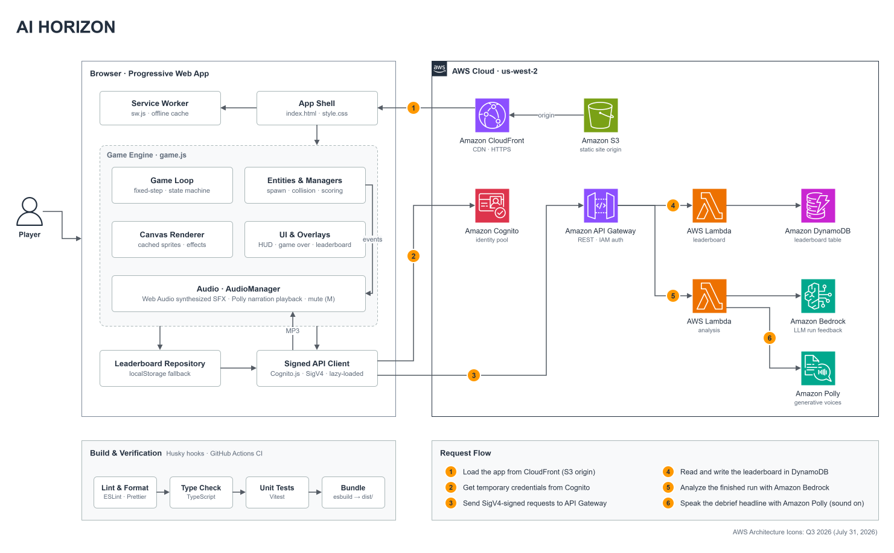

# AI HORIZON



An arcade-style space shooter for the browser: collect stars, blast asteroids, and beat the 90-second clock. Built with vanilla JavaScript and HTML5 Canvas, installable as a PWA, and backed by an optional serverless AWS leaderboard with AI run analysis. Controls and scoring are described on the [About page](https://www.agentmode.dev/about.html).

**Play now:** [agentmode.dev](https://www.agentmode.dev) (browser, installable) · [Google Play](https://play.google.com/store/apps/details?id=dev.agentmode.aihorizon)

After a run, **Share** on the leaderboard screen sends your score and the game link via the device's share sheet, or copies them to the clipboard where sharing isn't supported.

## Quick start

Requires Node 24+ (see `.nvmrc`; CI uses the same version).

```bash
npm install
npm run serve   # http://localhost:8000
```

## Commands

| Command            | Purpose                                   |
| ------------------ | ----------------------------------------- |
| `npm run serve`    | Dev server at http://localhost:8000       |
| `npm run build`    | Production build into `dist/`             |
| `npm test`         | Unit tests (Vitest)                       |
| `npm run ci:local` | Lint, format check, type check, and tests |

## Deploy

Copy the contents of `dist/` to static HTTPS hosting (production uses Amazon S3 behind CloudFront). The Lambda functions for the leaderboard and run analysis live in `server/lambda/`; the client's AWS endpoints are configured in `js/adapters/awsConfig.js`.

Link previews (Open Graph / Twitter card tags in `index.prod.html` and `about.html`) point at `https://www.agentmode.dev/og-image.png`, which the build copies from `store-screenshots/ai-horizon-1024x500.png`. Update those URLs, and `CONFIG.SHARE.URL` in `js/constants.js`, if the game moves to another domain.

## URL flags

- `?seed=12345` — reproducible run
- `?autoplay=1` — autopilot plays the game
- `?debug=perf` — on-screen performance overlay

## Project layout

- `js/` — game source (core, entities, managers, systems, UI, AWS adapters)
- `server/lambda/` — AWS Lambda functions
- `tests/` — Vitest unit tests
- `scripts/` — headless-Chrome tooling (benchmarks, screenshots, recordings)
- `docs/` — architecture diagram (`architecture.drawio` is the editable source)
